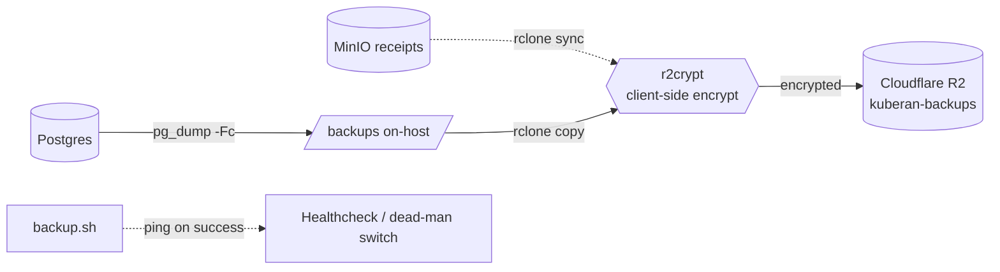
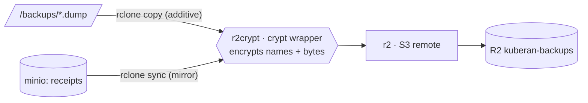

# Backup & Disaster Recovery

Off-host, client-side-encrypted replication of the Postgres dumps and the MinIO
receipts bucket to Cloudflare R2. This is the operational reference: topology,
one-time setup (Cloudflare + rclone), enabling, restore drills, and failure
response. It was introduced by plan 017 Phase 0 and is independent of the
receipts feature — it works with or without receipts deployed.

The on-host piece (`apps/backup/backup.sh`, cron via supercronic) runs
`pg_dump -Fc` of the app database **and** of Hydra's `hydra` database into a
host bind mount, verifying every dump. The **off-host** leg below makes sure a
single disk loss can't take out the DB and every backup at once.

> **Upgrading an existing install?** Read [Upgrade notes](#upgrade-notes)
> first: the compose file, networks, container users and backup ownership
> changed.

The off-host copy is driven by [**rclone**](https://rclone.org/) — an
open-source command-line tool for copying and syncing files to and between
cloud / S3-compatible object stores (think "rsync for object storage"). It is
already installed in the backup image (`apps/backup/Dockerfile`); you configure
it entirely through environment variables (see §2), so there's no `rclone.conf`
to manage.

## Topology



- `backup.sh` runs on the supercronic schedule (daily 02:00 UTC) inside the
  `backup` service (behind the `backup` compose profile), once at container
  start, and once before every deploy's migrations (`deploy/deploy.sh`, files
  labelled `predeploy`).
- On-host `/backups` keeps `BACKUP_RETENTION_DAYS` (default 30) of `.dump` files.
  See [On-host dumps](#on-host-dumps) for names, verification and permissions.
- `r2crypt` is an rclone **crypt** remote wrapping the `r2` S3 remote, so both
  filenames and contents are encrypted before leaving the host — Cloudflare
  stores only ciphertext.
- The receipts mirror activates automatically once receipts deploy: the compose
  `backup` service sets `RECEIPTS_BUCKET`, and it `depends_on` `minio-init`, so a
  reboot can't fire the mirror before MinIO is provisioned. It stays a no-op
  only while the `RCLONE_CONFIG_MINIO_*` source remote is unconfigured.

## On-host dumps

Each run writes, to `./backups` on the host (`/backups` in the container):

| File | Contents |
|---|---|
| `kuberan_<ts>.dump` | App database (`DB_NAME`) |
| `hydra_<ts>.dump` | Hydra's database (`BACKUP_HYDRA_DB_NAME`, default `hydra`), when it is a separate database on the same server. On Supabase Hydra is a schema inside the main database, so it is already in `kuberan_<ts>.dump` and this file is skipped. |
| `kuberan_predeploy_<ts>.dump`, `hydra_predeploy_<ts>.dump` | Same, taken by `deploy.sh` right before migrations (no receipts mirror). |

Hardening in `backup.sh`:

- **Verified dumps.** Each dump is written as `<file>.partial`, read back
  completely with `pg_restore --list`, and only then renamed to `.dump`. A
  failed or truncated dump never looks valid and fails the run (no
  healthcheck ping).
- **Owner-only files.** `umask 077`: dumps are `0600`, owned by the backup
  container's unprivileged user (uid `10001`).
- **No password in the environment of child processes.** The DB password is
  written to a `0600` `.pgpass` on the container's `/tmp` tmpfs (removed on
  exit) instead of being exported as `PGPASSWORD`, and unset before `pg_dump`,
  `rclone` and `curl` run. `DB_SSLMODE` is honoured (`require` on Supabase).
- **Missing off-host copy is loud.** Without R2 configured every run logs a
  boxed `WARNING` that backups exist only on this host. Set
  `BACKUP_REQUIRE_OFFHOST=true` to make that a failure (no healthcheck ping),
  which is recommended once R2 is set up.

## Off-host replication is optional

`backup.sh` guards the whole off-host leg on `RCLONE_CONFIG_R2CRYPT_REMOTE`.
Leave it unset and the service keeps making on-disk-only backups (with the
warning above). Everything below is only needed for the off-host copy.

> Only the `RCLONE_CONFIG_*` variables listed under the `backup` service in
> `docker-compose.prod.yml` reach the container. If you rely on any other
> rclone option variable, add it there.

---

## 1 · Cloudflare R2 (one-time, in the dashboard)

### 1a. Create the bucket

**R2 → Overview → Create bucket**. Name it `kuberan-backups`. A **Standard**
bucket is fine. The location/jurisdiction changes your endpoint host (EU
buckets use `.eu.r2…`).

### 1b. Note your Account ID → endpoint

The R2 Overview shows the S3 API endpoint. This is `RCLONE_CONFIG_R2_ENDPOINT`:

```
https://<ACCOUNT_ID>.r2.cloudflarestorage.com
# EU jurisdiction: https://<ACCOUNT_ID>.eu.r2.cloudflarestorage.com
```

### 1c. Create a scoped S3 API token

**R2 → Manage R2 API Tokens → Create**. Choose permission **Object Read &
Write** and **Apply to specific buckets only → `kuberan-backups`** (least
privilege — no admin, no other buckets). On create you get an **Access Key ID**
and a **Secret Access Key**; the **secret is shown once**, so copy both now.

```
Access Key ID      → RCLONE_CONFIG_R2_ACCESS_KEY_ID
Secret Access Key  → RCLONE_CONFIG_R2_SECRET_ACCESS_KEY
```

### 1d. Protect the off-host copy from tampering (bucket lock)

**R2 has no object versioning** — `PutBucketVersioning`/`GetBucketVersioning`
are unimplemented in R2's S3 API, so there is no "restore a prior version" after
a bad write. R2's equivalent protection is a **Bucket Lock**: a retention / WORM
policy (bucket **Settings → Bucket Lock**, or the API) that blocks objects from
being deleted or overwritten for a set period — or indefinitely. Apply one to
`kuberan-backups` so the append-only DB dumps (pushed with `rclone copy`) can't
be tampered with or deleted, even by a compromised host.

The receipts mirror is the subtle case: it uses a destructive `rclone sync`
(§2), which deletes remote objects that are gone from source. Because R2 can't
version, a bad sync is otherwise unrecoverable, and a bucket lock would *reject*
the sync's own deletes (fighting each other). So keep the two workloads apart:
lock only the **`db/` prefix** (or put the dumps in a separate, fully-locked
bucket), and leave the **`receipts/`** prefix unlocked so the mirror can run.
Then make that mirror non-destructive with rclone's `--backup-dir`, which
**moves** would-be-deletions to a timestamped prefix instead of erasing them — a
recovery trail without versioning. `backup.sh` does not pass `--backup-dir`
yet; see the note in §2.

---

## 2 · rclone configuration (`.env.prod`)

The remotes are defined entirely by env vars — no `rclone.conf` file. Copy the
block from `.env.prod.example` and fill it in:

```ini
# r2: raw S3 remote — the token + endpoint from step 1
RCLONE_CONFIG_R2_TYPE=s3
RCLONE_CONFIG_R2_PROVIDER=Cloudflare
RCLONE_CONFIG_R2_ACCESS_KEY_ID=<access key id>
RCLONE_CONFIG_R2_SECRET_ACCESS_KEY=<secret access key>
RCLONE_CONFIG_R2_ENDPOINT=https://<ACCOUNT_ID>.r2.cloudflarestorage.com

# r2crypt: encryption wrapper around r2:kuberan-backups
RCLONE_CONFIG_R2CRYPT_TYPE=crypt
RCLONE_CONFIG_R2CRYPT_REMOTE=r2:kuberan-backups
RCLONE_CONFIG_R2CRYPT_PASSWORD=<rclone obscure output>
RCLONE_CONFIG_R2CRYPT_PASSWORD2=<rclone obscure output, salt>

# minio: source for the receipts mirror — SAME scoped keys as STORAGE_*
RCLONE_CONFIG_MINIO_TYPE=s3
RCLONE_CONFIG_MINIO_PROVIDER=Minio
RCLONE_CONFIG_MINIO_ACCESS_KEY_ID=<= STORAGE_ACCESS_KEY>
RCLONE_CONFIG_MINIO_SECRET_ACCESS_KEY=<= STORAGE_SECRET_KEY>
RCLONE_CONFIG_MINIO_ENDPOINT=http://minio:9000

# dead-man's-switch (pinged only on full success)
HEALTHCHECK_URL=https://hc-ping.com/<uuid>
```

Generate the crypt passphrases locally and **also store the plaintext in an
off-VPS password manager** — losing them makes every off-host copy permanently
unrecoverable (`rclone obscure` only prevents shoulder-surfing; rclone can
reverse it):

```sh
rclone obscure 'a-long-random-passphrase'   # -> RCLONE_CONFIG_R2CRYPT_PASSWORD
rclone obscure 'a-second-random-salt'        # -> RCLONE_CONFIG_R2CRYPT_PASSWORD2
```

### How the three remotes compose



- **`r2`** is the raw S3 remote; you never write to it directly.
- **`r2crypt`** wraps `r2:kuberan-backups` and encrypts filenames + contents
  client-side.
- **`minio`** is the mirror **source** — the same scoped service account the API
  uses (`STORAGE_ACCESS_KEY`/`STORAGE_SECRET_KEY`), which already has
  `ListBucket` + `GetObject`.
- **copy** (DB dumps) never deletes; local retention prunes them. **sync**
  (receipts) mirrors deletes remote extras — and since R2 has no versioning
  (§1d), a bad sync is destructive.

### Notes / gotchas

- **rclone ≥ v1.59** — older versions return `401` against R2.
- `backup.sh` passes `--s3-no-check-bucket`, R2's recommended `no_check_bucket`
  behavior for object-scoped tokens, so a scoped token won't error trying to
  HEAD the bucket.
- `RECEIPTS_BUCKET` is supplied by the compose `backup` service (`= STORAGE_BUCKET`);
  you don't set it by hand.
- **Receipts mirror is destructive today.** `backup.sh` runs `rclone sync`
  without `--backup-dir`, so a source-side loss propagates to R2 with no
  recovery trail (R2 can't version). Hardening this — adding `--backup-dir` so
  deletions are moved aside — is a recommended follow-up. The DB dumps use
  `rclone copy` and are not exposed to this.

---

## 3 · Enable & verify

```sh
# Bring the backup service up (it's behind the `backup` profile).
COMPOSE_PROFILES=backup ./deploy/deploy.sh

# Trigger a one-off run inside the running service.
docker compose -f docker-compose.prod.yml exec backup /backup.sh

# Confirm the encrypted objects landed (decrypted listing via the crypt remote):
# one kuberan_<ts>.dump and, self-hosted, one hydra_<ts>.dump per run.
docker compose -f docker-compose.prod.yml exec backup rclone ls r2crypt:db/
```

A full-success run also flips the healthcheck to "up". Because `backup.sh` runs
under `set -eu`, any earlier failure aborts before the healthcheck ping — so a
**missed ping means the run failed** somewhere before the dead-man's-switch line.

## 4 · Restore drill (do this once before relying on it)

### 4a. Automated restore test

`apps/backup/restore-test.sh` (in the backup image as `/restore-test.sh`)
restores the newest `kuberan_*.dump` into a scratch database
(`RESTORE_TEST_DB`, default `kuberan_restore_test`) on the same server, checks
that `schema_migrations` is clean and that users exist, prints row counts, and
drops the scratch database again (also on failure). It refuses to use the
production, `hydra` or system database names.

```sh
# Run it now against the newest dump (or pass a path to a specific dump):
docker compose -f docker-compose.prod.yml exec backup /restore-test.sh --force
```

The backup container's crontab also runs it weekly (Sunday 03:30 UTC), as a
no-op unless `RESTORE_TEST_ENABLED=true` is set in `.env.prod`. Optionally set
`RESTORE_TEST_HEALTHCHECK_URL` to a second dead-man's-switch so a failing drill
alerts you. It needs `CREATEDB` (the self-hosted `kuberan` role has it); on
Supabase run the manual drill below instead.

### 4b. Manual drill (off-host copy)

Restore into a **scratch database**, never straight over production.

```sh
# 1. Pull the newest encrypted dump back and decrypt it in one step.
rclone copy r2crypt:db/ ./restore/ --include '*.dump'

# 2. Restore into a fresh scratch DB.
createdb kuberan_restore
pg_restore --no-owner --no-acl -d kuberan_restore ./restore/kuberan_<ts>.dump

# 3. Sanity-check row counts against expectations.
psql -d kuberan_restore -c '\dt'
psql -d kuberan_restore -c 'SELECT count(*) FROM transactions;'

# 4. (Once receipts deploy) restore the receipts bucket.
rclone copy r2crypt:receipts/ minio:kuberan-receipts/ --s3-no-check-bucket
```

Verify the app boots against the scratch DB, then drop it.

For a real disaster recovery, restore Hydra too (self-hosted:
`createdb hydra && pg_restore --no-owner --no-acl -d hydra hydra_<ts>.dump`),
otherwise every connected MCP client has to re-register and re-consent.

## 5 · Failure response

| Symptom | Likely cause | Action |
|---------|--------------|--------|
| Healthcheck flips to "down" | `pg_dump`, `rclone`, or connectivity failed | Read the backup container logs; the last `log` line marks the failing step. |
| `rclone` auth error | Rotated/expired R2 token | Regenerate the R2 token, update `RCLONE_CONFIG_R2_*` in `.env.prod`, redeploy. |
| Decrypt fails on restore | Wrong passphrase | Use the passphrase pair from the off-VPS password manager; both `PASSWORD` and `PASSWORD2` must match. |
| Receipts mirror deleted objects | Bad `sync` (R2 has no versioning) | Recover from the `--backup-dir` trail if enabled; otherwise re-mirror from the live MinIO source bucket. Prevent recurrence per §1d. |
| `Permission denied` writing `/backups` | `./backups` still owned by root from an older deploy | Re-run `./deploy/deploy.sh` (it chowns `./backups` to uid 10001), or `sudo chown -R 10001:10001 backups`. |
| `failed verification (pg_restore --list)` | Dump truncated (disk full, connection drop) | Check host disk space and DB connectivity; the bad file was deleted, the previous dumps are intact. |

---

## 6 · Deploys and rollback

`deploy/deploy.sh` (run from `/opt/kuberan`):

1. Builds every image tagged with the short git SHA (`kuberan-api:<sha>`, ...).
2. Starts/recreates `postgres` (self-hosted) and waits for it to be healthy.
3. Takes a pre-migration backup (`*_predeploy_*.dump`) when the `backup`
   profile is enabled. A failed backup aborts the deploy before migrations.
   `SKIP_BACKUP=1` skips it (not recommended).
4. Runs the migrations.
5. `docker compose up -d --wait`: returns only once every long-running service
   is healthy (`WAIT_TIMEOUT`, default 300 s), otherwise the deploy fails.
6. Points `:latest` at the new images (cron's `compose run oracle` uses it),
   keeps the newest `KEEP_IMAGES` (default 3) tags per image for rollback and
   prunes only older tags and dangling layers.

On any failure it prints the failing stage and the exact rollback commands.

### Rollback

Images only (no schema change, or a backwards-compatible one):

```sh
docker image ls kuberan-api        # pick the previous tag
PREV=<previous-sha>
for i in kuberan-api kuberan-web kuberan-bot kuberan-oracle kuberan-backup; do
  docker image inspect $i:$PREV >/dev/null 2>&1 && docker tag $i:$PREV $i:latest
done
IMAGE_TAG=$PREV docker compose -f docker-compose.prod.yml --env-file .env.prod up -d --no-build
```

The first deploy after this change tags the images that were running as
`pre-<sha>` so they remain a rollback target. For a full rollback (compose
file too), `git checkout <previous-sha>` and re-run `./deploy/deploy.sh`.

If a migration must be undone, prefer `migrate down 1` for a single
reversible migration:

```sh
docker compose -f docker-compose.prod.yml --env-file .env.prod \
  run --rm --no-deps -e DB_PORT=5432 --entrypoint /migrate api down 1
```

otherwise restore the `kuberan_predeploy_<ts>.dump` taken by that deploy
(stop api/mcp/bot first, restore into a fresh database per §4, then swap
`DB_NAME`).

---

## Upgrade notes

For an existing install upgrading to the hardened compose/deploy setup. The
deploy itself is automatic (`git pull && ./deploy/deploy.sh`): it builds the
api and web together, takes a pre-migration backup, runs migrations, recreates
every service (including Hydra, so the new config applies) and waits for
health. Before running it:

- **Required — edit `.env.prod`:** `JWT_SECRET` must be at least 32 bytes
  (`openssl rand -hex 32`; changing it signs everyone out once) and
  `CORS_ORIGIN` must be the exact web origin, e.g. `https://app.<domain>`.
  `deploy.sh` checks both and stops before building if either is wrong.
- **Check:** your tunnel routes point at `localhost`/`127.0.0.1` (step 1),
  `172.30.x` is free on the host (step 2), and decide on the MinIO image
  (step 7).

Everything else below is informational.

1. **Ports are loopback-only.** api `8080`, mcp `8081`, hydra `4444` and web
   `3000` now publish on `127.0.0.1` (`PUBLISH_ADDRESS`). A tunnel connector
   (`cloudflared`) running **on the host** keeps working; make sure its
   routes point at `http://127.0.0.1:<port>` or `http://localhost:<port>`
   (not the VPS's public IP). If your connector runs in a Docker container,
   either switch it to `network_mode: host`, or attach it to the
   `kuberan_edge` network and route to `http://api:8080` etc. Do **not** set
   `PUBLISH_ADDRESS=0.0.0.0` on a host with a public IP.
2. **Fixed networks.** Services now sit on `kuberan_edge`
   (`172.30.10.0/24`), and the internal `kuberan_db`, `kuberan_storage` and
   `kuberan_hydra-admin` networks (`172.30.11-13.0/24`). If any of those
   ranges is already used on the host (`docker network inspect $(docker
   network ls -q) | grep Subnet`), set `KUBERAN_SUBNET_PREFIX` (e.g.
   `10.231`) in `.env.prod` and adjust the CIDRs in step 3. The old
   `kuberan_default` network is left unused; remove it with
   `docker network rm kuberan_default` after a successful deploy. Because
   every container moves networks, this first deploy recreates `postgres`
   before the backup and migrations, so the old api is briefly without its
   database (expect about a minute of downtime).
3. **Narrow the trusted proxy ranges** in `.env.prod` (the old
   `172.16.0.0/12` keeps working, but trusts every Docker network):
   `MCP_TRUSTED_PROXY_CIDRS=172.30.10.0/24`,
   `HYDRA_TLS_TERMINATION_CIDR=172.30.10.0/24`,
   `API_TRUSTED_PROXY_CIDRS=172.30.10.0/24`.
4. **No more shared env_file.** Each service gets only the variables listed for
   it in `docker-compose.prod.yml`. Newly required in `.env.prod`:
   `CORS_ORIGIN` (exact origin, e.g. `https://app.<domain>`; `*` is rejected
   in production). Make sure `TELEGRAM_BOT_TOKEN` and `BOT_INTERNAL_SECRET`
   are set if you run the bot. `HYDRA_ADMIN_URL` and `PORT` in `.env.prod`
   are now ignored (fixed in compose). If you had added custom variables to
   `.env.prod` for a service (e.g. extra `RCLONE_CONFIG_*` keys), add them to
   that service's `environment:` block.
5. **Hydra admin isolation.** Hydra's admin API now binds only to its fixed
   address on the internal `hydra-admin` network (`172.30.13.10:4445`), which
   only the api joins; the api reaches it as `http://hydra-admin:4445`.
6. **Non-root containers.** api, mcp, bot and backup run as uid `10001`.
   `deploy.sh` chowns `./backups` to `10001:10001` automatically before the
   pre-migration backup. Existing dumps stay readable.
7. **MinIO image.** Upstream `minio/minio` and `minio/mc` are no longer
   published on Docker Hub, so `minio` and `minio-init` now use a pinned
   build of the community-maintained fork `pgsty/minio` (same server code and
   on-disk format; `minio-init` uses the `mc` shipped in that image). To keep
   running the upstream image you already have cached, set
   `MINIO_IMAGE=minio/minio:latest` in `.env.prod` (it then also serves as the
   `mc` image for `minio-init`). Take a backup of the `minio_data` volume
   first if you switch.
8. **Backups.** The backup run now also dumps the `hydra` database, verifies
   every dump, and warns loudly without off-host replication. Consider
   `BACKUP_REQUIRE_OFFHOST=true` and `RESTORE_TEST_ENABLED=true` (§4a).
9. **Bot.** The bot only answers in private chats, and its container has a
   heartbeat-based healthcheck. Log level comes from `LOG_LEVEL` (default
   `INFO`).
10. **Images are tagged by git SHA** and the last three are kept; see §6.
11. **Stricter production config.** The api, mcp and migrate binaries refuse
    to start in production unless `JWT_SECRET` is at least 32 bytes and
    `CORS_ORIGIN` lists the exact web origin(s) (no `*`); `deploy.sh`
    preflights both.
12. **Refresh token cookie.** The refresh token moved to an HttpOnly
    `kuberan_refresh` cookie and is no longer in the login response body.
    `deploy.sh` ships the api and web together, and the new web build
    migrates existing sessions on first load. Browser tabs still running the
    old bundle need one reload.
13. **Migrations 000035–000036** run on startup: aggregate indexes (and two
    redundant indexes dropped), and a unique index on Telegram link codes
    (pending link codes are cleared, so anyone mid-link must generate a new
    code).
14. **PKCE is enforced** for public clients (Hydra is recreated by the
    deploy, so no manual restart). MCP clients that skip PKCE are refused at
    authorize time.
15. **Rate limits** apply to login, register, refresh and client registration
    (`RATE_LIMIT_*`). They key on the client IP; `API_TRUSTED_PROXY_CIDRS`
    and `MCP_TRUSTED_PROXY_CIDRS` default to the edge network
    (`172.30.10.0/24`) so this works without changes. If you set
    `KUBERAN_SUBNET_PREFIX`, set both to match.

---

See also: [receipts.md](receipts.md) for the storage service setup, and
`.env.prod.example` for the full annotated variable list.
