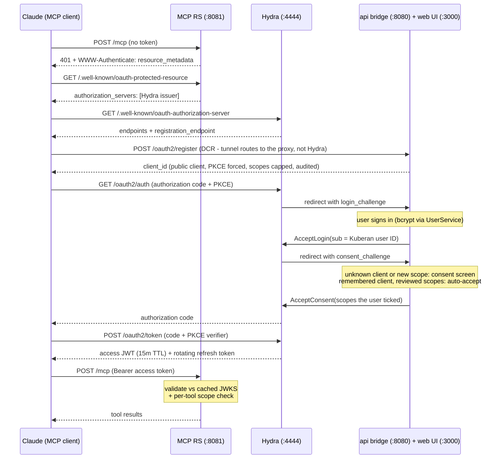

# MCP OAuth 2.1 via Ory Hydra

How the Kuberan MCP server authenticates MCP clients (Claude connectors), why
Ory Hydra is the authorization server, and how the pieces fit together.

Implementation history lives in `plans/015-mcp-oauth-hydra/`; the live-ops
checklist (E2E verification, Cloudflare hardening) is
`plans/015-mcp-oauth-hydra/PHASE-3-5-RUNBOOK.md`.

---

## Why OAuth, and why Hydra

The MCP server originally used a hand-issued, 1-year static JWT: minted via
`POST /auth/mcp-token`, copy-pasted into client config, hash stored on the user
row for revocation. That path is deleted. It had no refresh mechanism, required
manual rotation, and was not the flow MCP clients drive: Claude connectors are
added by URL and expect to run an **OAuth 2.1 authorization-code flow with
Dynamic Client Registration (DCR, RFC 7591)** - the client registers *itself*
as an OAuth client, no human pre-registers anything.

That DCR requirement decided the authorization server:

| Criterion | Roll our own AS | Zitadel | **Ory Hydra** |
|---|---|---|---|
| DCR (RFC 7591) - MCP hard requirement | Build it | Not supported | **Built-in** |
| Security-critical crypto authored by us | All of it | None | **None** |
| User store / login UI | Have it | Included (unused) | **Reuse `UserService`** |

Hydra is *headless*: it manages no users. When a login or consent decision is
needed, Hydra redirects to URLs we own with a challenge token, and we answer
via its private admin API. That keeps Kuberan's existing `UserService` (bcrypt,
lockout, `IsActive`) as the sole identity source - no second user store, no Ory
Kratos.

## Components

| Component | Where | Role |
|---|---|---|
| Ory Hydra (`oryd/hydra`, pinned in compose) | `:4444` public, `:4445` admin | Authorization Server: authorize/token endpoints, JWKS signing keys, refresh rotation, client store |
| MCP server | `apps/api/cmd/mcp`, `internal/mcp/`, `:8081` | OAuth **Resource Server**: validates access tokens offline against Hydra's JWKS |
| Login/consent bridge | `internal/handlers/oauth_handler.go`, `internal/hydra/` | Browser-callable endpoints that resolve Hydra's login/consent challenges via the admin API (the browser never talks to `:4445`) |
| Hardened DCR proxy | `internal/handlers/registration_handler.go`, served at `/oauth2/register` on `:8080` | Fronts client self-registration: forces public clients (`token_endpoint_auth_method=none`; Hydra then requires PKCE S256 for them, see below), restricts grants to `authorization_code`/`refresh_token`, caps scopes to the registered API set (`read:*`, plus `write:*` when `MCP_WRITE_ENABLED`; a client requesting no scopes gets the full set rather than an unusable empty-scope client) and always registers `openid offline offline_access`, bounds the metadata (see "DCR limits"), audits + alerts every registration |
| Login/consent pages | `apps/web` `/oauth/login`, `/oauth/consent` | UI for Hydra's login/consent redirects; per-scope checkboxes, write scopes in a separate "Allow changes" section, unticked by default |
| `oauth_client_grants` table | migration `000033` + `internal/services/oauth_grant_service.go` | Per-user, per-scope consent: what each client was granted and which scopes the user has reviewed. A remembered client auto-accepts only for reviewed scopes. Backs Settings > Connected apps and the MCP write guard (plan 022) |

Hydra stores its own tables via `hydra migrate sql` (the `hydra-migrate`
compose service) in a dedicated database/schema on the same Postgres instance -
**not** managed by golang-migrate. On Supabase this is a `hydra` schema +
dedicated role, targeted via `&search_path=hydra` in `HYDRA_DSN` over the
session pooler (port 5432; Hydra's long-lived connections break on the 6543
transaction pooler).

## The flow (first connect)



The login bridge (`POST /api/v1/oauth/login`) first fetches the
`login_challenge` from Hydra and only then checks the credentials, so a
forged or spent challenge gets a 404 without revealing whether the password
was right or touching the lockout counter. Malformed request bodies get a
generic `INVALID_INPUT` message (binding errors are not echoed).

Both interactive steps have an active refusal path: Cancel on the login page
and Deny on the consent screen call `POST /api/v1/oauth/login/reject` /
`POST /api/v1/oauth/consent/reject`, which reject the challenge via Hydra's
admin API and abort the flow (the anti-phishing tripwire from plan 15).

Every request to `/mcp` without a valid Bearer token gets an HTTP **401** with
a `WWW-Authenticate: Bearer resource_metadata="..."` challenge
(`requireBearer` + `withWWWAuthenticate` in `internal/mcp/server.go`). This
401 is not just access control - it is what *triggers* the client's OAuth
discovery. In-band tool errors over HTTP 200 do not.

## Token validation (Resource Server)

`internal/mcp/validator.go` (`HydraValidator`) validates offline against
Hydra's cached JWKS - no per-request DB or network hop:

- RS256 signature, `exp`/`nbf`, `iss` == Hydra issuer, `aud` contains
  `MCP_RESOURCE_URL`.
- `sub` is the Kuberan user ID (set by the bridge at `AcceptLogin`).
- `client_id` is the OAuth client; the write guard checks it against the
  user's grant (see "Write access").
- Scopes: Hydra emits them as the **`scp` claim (JSON array)**; the validator
  reads `scp` first and falls back to `scope` (space-delimited string, the
  convention other servers use). See "hard-won interop notes" below.

Each MCP tool then enforces its required scope via `requireScope` (e.g.
`list_accounts` needs `read:accounts`). The canonical scope set is
`config.DefaultOAuthScopes`, plus `config.DefaultOAuthWriteScopes` when
`MCP_WRITE_ENABLED` is set; Hydra v2.x has no global scope registry, so scope
policy is enforced entirely code-side (DCR proxy caps, consent bridge grants
the subset the user ticks, RS enforces per tool).

The token is validated once per request: `requireBearer` validates it and
attaches the claims to the request context, and the MCP context function
(`makeAuthFromRequest`) only copies them into the tool context.

JWKS downloads are serialized (concurrent unknown-`kid` misses wait for one
download), throttled to one per 30s on success and one per 5s after a
failure, and the body is capped at 1 MiB.

**Deactivated users.** A refresh token keeps minting valid access tokens, so
`requireBearer` also checks that the token's user still exists and is active
(`internal/mcp/active.go`, cached per user for 60s; a database failure returns
503 and is not cached). A deactivated user gets a 401 on every MCP request
within a minute, for reads as well as writes, and re-authorizing fails at
login. To also kill the refresh tokens, call
`services.RevokeUserOAuthAccess(ctx, hydraAdmin, grants, userID)` wherever a
user is deactivated: it revokes all of the user's Hydra consent sessions
(`DELETE /admin/oauth2/auth/sessions/consent?subject=&all=true`) and login
sessions, then marks every grant revoked. (There is no deactivation flow in
the app today; wire it in when one is added.)

### Long-lived connections (refresh tokens)

Hydra only issues a refresh token when `offline_access` (or `offline`) is
granted, and refuses to refresh a grant whose scopes exceed the client's
registered set. MCP clients often register and authorize with just the RS's
`scopes_supported` (`read:*`), which would leave them with a bare 15-minute
access token and force re-authorization. So:

- the DCR proxy always registers `openid offline offline_access`;
- the consent bridge grants `offline_access` whenever the client is registered
  for it, even if it was not requested (`withOfflineAccess`);
- `ttl.refresh_token` is `2160h` (refresh tokens rotate, so this is an idle
  timeout of 90 days);
- `oauth2.grant.refresh_token.rotation_grace_period` is `5m`, so a concurrent
  or retried refresh does not trip Hydra's reuse detection and revoke the chain.

Clients registered before this change lack `offline_access` in their
registration; remove and re-add the connector so it re-registers.

## PKCE

Hydra does **not** require PKCE by default, not even for public clients.
`ory/hydra/hydra.yml` sets `oauth2.pkce.enforced_for_public_clients: true`,
and every DCR client is public, so every self-registered client must send a
PKCE challenge (S256; Hydra does not accept `plain`). `oauth2.pkce.enforced`
stays `false` so a confidential client pinned via `HYDRA_PINNED_CLIENT_ID`
(authenticating with a secret) keeps working without PKCE; set it to `true`
if no such client exists.

## DCR limits

Registration is public (rate limited in `routes.go`), so the proxy bounds
everything a client submits:

- body at most 16 KiB (`http.MaxBytesReader`);
- 1 to 3 `redirect_uris`, each at most 2048 characters, no fragment, no
  userinfo, and one of: `https://` with a host; `http://` only on a loopback
  host (`127.0.0.1`, `[::1]`, `localhost`, RFC 8252 7.3); or a private-use
  native-app scheme (RFC 8252 7.1 prefers reverse-DNS like
  `com.example.app:/callback`, but single-word schemes such as `cursor://`
  and `vscode://` are accepted because common MCP clients use them; the
  consent screen warns when the target is a custom scheme). `javascript:`,
  `data:`, `file:`, `vbscript:`, `blob:`, `about:` and similar are always
  refused;
- `client_name`: control and format characters (newlines, bidi overrides,
  zero-width characters) become spaces, whitespace is collapsed, and it is
  cut to 100 characters.

Not implemented: clients that register but are never consented to stay in
Hydra indefinitely. A periodic sweep would need to list Hydra clients and
compare them with `oauth_client_grants` and Hydra consent sessions; for now,
review `OAUTH_CLIENT_REGISTERED` audit events and delete strays with
`hydra delete oauth2-client`.

## Consent and connected apps

The consent screen shows where this authorization will send the user back
to: the `redirect_uri` of the authorization request itself, parsed from
Hydra's consent `request_url` (a client may register several URIs, so the
first registered one is not necessarily in use; when the request names none,
the client's only registered URI). The API returns `redirect_scheme` and
`redirect_host` (host only for http/https); for a private-use scheme the page
shows the scheme and warns that control passes to an installed app. Every
DCR client named itself, so the page labels the name unverified;
`client_verified` is true only for the client configured with
`handlers.WithPinnedClientID` (`HYDRA_PINNED_CLIENT_ID`). Both OAuth pages
only follow a Hydra `redirect_to` that is an absolute http(s) URL.

Consent decisions are stored per user and client in `oauth_client_grants`
(plan 022): `approved_scopes` (granted), `reviewed_scopes` (shown on the
consent screen, granted or not) and `auto_accept` ("remember this
application").

- **Auto-accept** happens only when the grant is remembered, not revoked, and
  every requested scope is already in `reviewed_scopes`. It grants the
  requested scopes the user approved, never more. A client that starts asking
  for a new scope (for example `write:transactions` after writes are enabled)
  brings the consent screen back, with previous choices pre-ticked.
- **Accept** grants the scopes the user ticked (`granted_scopes`), capped to
  what the client requested and the registered set. If a request omits
  `granted_scopes`, only `read:*` is granted, so an outdated page can never
  grant write access. The grant row is written before Hydra issues anything.
  The decision is merged into the client's existing grant: scopes on this
  screen take the new choice, and scopes approved earlier but not requested
  this time keep their approval. One `OAUTH_CONSENT_GRANTED` audit event
  records the scopes and the "remember" choice (`auto_accept`).
- **Settings > Connected apps** (`GET /api/v1/oauth/clients`,
  `DELETE /api/v1/oauth/clients/:client_id`) lists active grants, plus any
  client Hydra still holds a consent session for without an active grant
  (shown as "connected before per-app permissions": typically a connector
  set up before migration `000033`, which can read but never write). If Hydra
  can't be reached the list falls back to grants only.
- **Disconnect** calls Hydra's
  `DELETE /admin/oauth2/auth/sessions/consent?subject=&client=` (revokes the
  consent and its refresh tokens) even when there is no grant row, then marks
  any grant revoked and audits `OAUTH_CLIENT_REVOKED`. If Hydra fails, nothing
  changes and the user can retry. An access JWT already issued keeps working
  for reads until it expires (15 minutes max) but is refused for writes at
  once (below).

## Write access (plan 022)

Off by default. `MCP_WRITE_ENABLED=true` (read by both `api` and `mcp`) adds
`write:transactions`, `write:categories` and `write:budgets` to the scope set
and registers the write tools:

| Scope | Tools |
|---|---|
| `write:transactions` | `create_transaction`, `create_transfer`, `update_transaction`, `categorize_transactions`, `record_repayment`, `write_off_receivable` |
| `write:categories` | `create_category`, `update_category` |
| `write:budgets` | `create_budget`, `update_budget` |

Nothing deletes records, and investments, accounts and fixed deposits stay
read-only. Every write tool is registered through `addWriteTool`
(`internal/mcp/write.go`), which runs the same steps for all of them:

1. the token carries the scope (`requireScope`);
2. the user's grant for the token's `client_id` is active, includes the scope,
   and the user is active: one indexed query per write, which is what makes
   disconnecting and deactivation take effect immediately for writes;
3. the tool validates its arguments (no side effects);
4. a per-(user, client) rate limit (`MCP_WRITE_RATE_PER_MINUTE`, default 30;
   `MCP_WRITE_RATE_PER_DAY`, default 500) plus a per-user limit across all of
   the user's clients at twice those values, charged only for valid writes,
   by the number of records changed (a batch's skipped items don't count). A
   write must fit both limits or neither is charged. The counters are held in
   memory **per MCP server instance** (restarts reset them; running several
   replicas would multiply the limits), and idle buckets are evicted after a
   day;
5. the write, then its audit rows, tagged with `via: "mcp"`, `client_id` and
   the tool name (updates record before and after values).

Tools bound every amount a write moves to `MCP_MAX_WRITE_AMOUNT` cents
(default $10,000), including ones not passed explicitly: a full write-off of
a receivable, and the existing amount of a transaction whose type is flipped.
Creates require a `date` (the user's local date; the server's UTC clock
can't know it), and dates must be within 10 years back and 7 days ahead.
Text limits (descriptions 500, names 100, icons 50 characters) are defined
and enforced in the services (`services/text_limits.go`), so REST and MCP
share them; the MCP tools also check them up front so invalid input never
counts against the rate limit. Flipping a transaction's type keeps its
category only if it fits the new type; a category that was deleted is
cleared, and the reply says so. Tools check that a
category belongs to the user (the service enforces this too) and matches the
transaction type. Amounts are in dollars, like the read tools' filters. All
tools carry MCP annotations (`readOnlyHint`, `destructiveHint`) so clients can
ask the user before a write, and every write tool's description tells the
model to confirm first.

## Tool input bounds and output hygiene

Tool arguments come from a language model, and through it from whatever text
it has read, so the read tools bound them before calling a service
(`internal/mcp/args.go`):

- dates must be `YYYY-MM-DD` within 1970..2100, and `to_date` must not
  precede `from_date` (an invalid date is an error, never silently dropped);
- per-day tools (`get_daily_spending`, `get_daily_summary`,
  `get_net_worth_history` with `group_by=day`) accept at most 366 days;
  aggregating tools (`get_spending_by_category`, `get_top_expenses`, grouped
  net worth) at most ten years;
- `months` is clamped to 1..24, `limit`/`page_size` to 1..100, `page` to
  1..1000; amount filters must be finite and at most $10^12;
- the `counterparty` filter is at most 255 bytes.

Tool output is read by the model too. Every user-controlled string printed by
a tool (descriptions, account/category/budget/security names, counterparties)
goes through one helper, `untrusted` (`internal/mcp/sanitize.go`): control and
format characters (newlines, ANSI escapes, bidi overrides, zero-width
characters) become spaces, whitespace is collapsed, the value is capped at
200 characters and printed in double quotes. A merchant name on an imported
statement can therefore not start a new output line or pose as tool output
or instructions. IDs, enums, dates and amounts are printed as-is.

`MCP_WRITE_ENABLED` alone decides whether write scopes exist: when it is off,
any `write:*` listed in an `OAUTH_SCOPES` override is stripped.

The audit IP is the TCP peer, or Cloudflare's `CF-Connecting-IP` only when the
peer is in `MCP_TRUSTED_PROXY_CIDRS` (the tunnel's Docker network); otherwise
anyone reaching the MCP port directly could forge it.

After enabling writes, remove and re-add the connector: existing DCR clients
were registered with `read:*` only, and Hydra refuses to authorize scopes
outside a client's registration. Runbook: `plans/015-mcp-oauth-hydra/PHASE-3-5-RUNBOOK.md` section 5.

## Deployment topology

Public ingress is an **external Cloudflare tunnel** (managed outside this
repo) that reaches services via host-published ports. Required mapping - order
matters, the path rule must precede the catch-all:

| Public hostname | Host port | Purpose |
|---|---|---|
| `auth.<domain>` path `/oauth2/register` | `:8080` (api) | Hardened DCR proxy |
| `auth.<domain>` all other paths | `:4444` (hydra) | Authorize, token, JWKS, discovery |
| `mcp.<domain>` | `:8081` (mcp) | Resource Server + protected-resource metadata |
| app domain `/oauth/login`, `/oauth/consent` | `:3000` (web) | Login + consent pages |

Hydra admin (`:4445`) is never published by compose and never mapped in the
tunnel. Routing `/oauth2/register` straight to Hydra would bypass every DCR
control.

Configuration is via `.env.prod` (see `.env.prod.example`): `HYDRA_DSN`,
`HYDRA_SECRETS_SYSTEM`, `HYDRA_ISSUER_URL`, `HYDRA_ADMIN_URL` (must be the
Docker-network URL `http://hydra:4445` - the localhost default silently breaks
the bridge), `HYDRA_LOGIN_URL`, `HYDRA_CONSENT_URL`, `MCP_RESOURCE_URL`, and
`HYDRA_TLS_TERMINATION_CIDR` (the Docker network CIDR the tunnel connects
from, so Hydra trusts `X-Forwarded-Proto: https` from cloudflared).

## Hard-won interop notes

These four bugs passed all unit tests and only surfaced against the real
Claude client + real Hydra. If auth breaks after an upgrade, start here:

1. **The 401 must be HTTP-level.** MCP clients begin OAuth discovery from a
   401 + `WWW-Authenticate` on the transport endpoint. Tool-level "unauthorized"
   results over HTTP 200 leave clients connected-but-broken.
2. **`registration_endpoint` is opt-in.** Hydra omits it from both discovery
   documents unless `webfinger.oidc_discovery.client_registration_url` is set
   (env: `WEBFINGER_OIDC_DISCOVERY_CLIENT_REGISTRATION_URL`, pointed at the
   DCR proxy). Without it, clients complete discovery and have nowhere to
   register.
3. **Scopes live in `scp`, not `scope`.** Hydra JWT access tokens carry granted
   scopes as an `scp` JSON array. A validator reading only `scope` sees zero
   scopes and every tool fails with "missing required scope".
4. **RFC 8414 needs Hydra >= v25.4.0.** Older Hydra 404s
   `/.well-known/oauth-authorization-server` and only serves
   `/.well-known/openid-configuration`. Clients should fall back, but serving
   the primary path removes the gamble. (Ory switched to CalVer; v25.x
   continues the 2.x line, config-compatible.)

There is a fifth latent ambiguity, documented with its fix in the runbook §2b:
the resource identity is host-only (`https://mcp.<domain>`), which is
spec-compliant as long as clients honor the `resource_metadata` hint. If a
strict client demands a path-inclusive identity (`.../mcp`), follow the runbook
- do not apply that change pre-emptively.

## Verifying a deployment

Fast checks (all should pass before involving a real client):

```sh
# 401 + resource_metadata challenge on the transport endpoint
curl -si -X POST https://mcp.<domain>/mcp | grep -i "HTTP\|www-authenticate"

# Protected Resource Metadata: resource, authorization_servers, scopes
curl -s https://mcp.<domain>/.well-known/oauth-protected-resource | jq

# AS metadata advertises a registration_endpoint; JWKS resolves
curl -s https://auth.<domain>/.well-known/oauth-authorization-server \
  | jq '{issuer, authorization_endpoint, token_endpoint, jwks_uri, registration_endpoint}'

# Admin port must be unreachable (expect timeout)
curl -si --max-time 5 https://auth.<domain>:4445/admin/clients

# DCR routes to the proxy, not Hydra: an invalid body must return the
# Kuberan AppError shape {"error":{"code":"INVALID_INPUT",...}}, not a Hydra error
curl -s -X POST https://auth.<domain>/oauth2/register -d 'not-json'
```

Then the real test: add a custom connector in Claude pointing at
`https://mcp.<domain>/mcp` and drive login -> consent -> tool calls -> wait out
the 15-minute TTL -> confirm silent refresh. Full pass criteria in the runbook.
